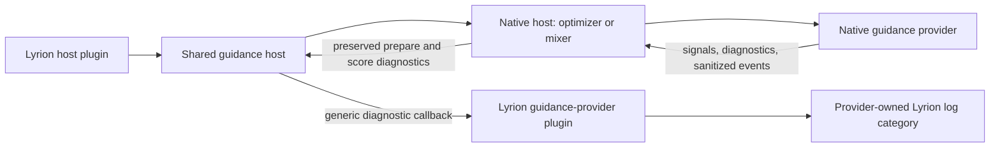
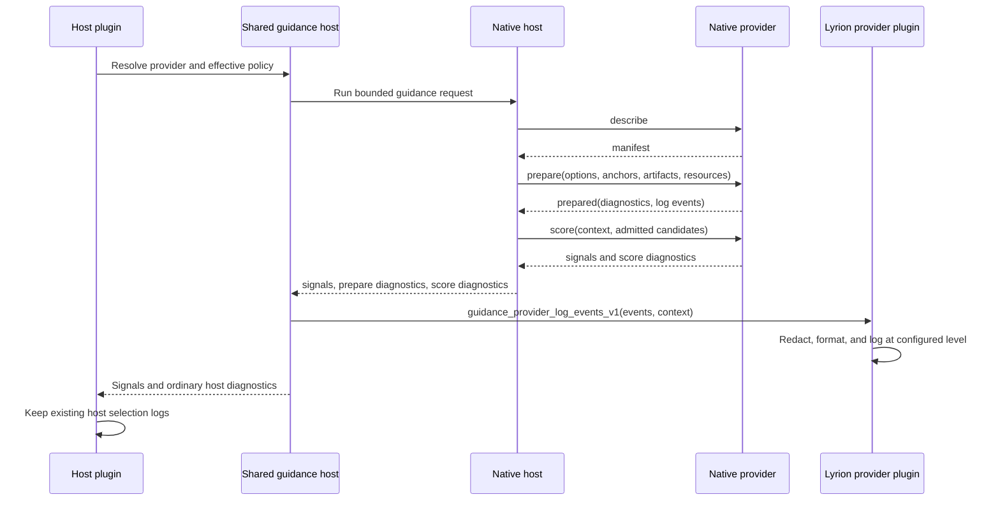

# Guidance Provider Observability Design

**Date:** 2026-10-14  
**Status:** Proposed  
**Primary owner:** `lms-bliss-guidance-host`  

## Purpose

Bliss Guidance providers need useful Lyrion logging without coupling native
provider processes to a particular host plugin. Last.fm logging should offer
the same practical visibility as LastMix: individual artist and track
lookups, cache use, returned results, sanitized JSON at DEBUG, and clear
failure diagnostics. Library Signals should expose equivalent provider-owned
visibility for database access, signal coverage, and source selection.

Existing Better Call Bliss and Bliss Mixer Lab selection logs remain
unchanged. Provider logs explain acquisition and preparation; host logs
continue to explain how guidance affected a host-specific selection.

## Current constraints

- Native providers reserve stdout for `bliss-guidance-jsonl-v2`.
- `bliss-mixer` and `bliss-playlist-optimizer` currently discard provider
  stderr and do not expose every `prepare` diagnostic to Perl.
- The shared Perl runtime returns score diagnostics but does not relay
  provider-owned log events.
- LastMix logs API calls and cache hits at INFO, decoded response structures at
  DEBUG, and HTTP/API/JSON failures at ERROR.
- The Last.fm API key must never appear in environment diagnostics, request
  artifacts, JSONL responses, logs, cache diagnostics, or crash output.

## Ownership

| Component | Responsibility |
| --- | --- |
| Native provider | Perform acquisition and scoring; emit structured, sanitized diagnostics and bounded log events. |
| Native host (`bliss-mixer` or optimizer) | Preserve prepare and score diagnostics and return them to the Perl host. |
| Shared Lyrion guidance host | Dispatch structured events to the discovered provider through an optional generic callback. |
| Lyrion provider plugin | Own its log category, levels, message formatting, and provider-specific redaction. |
| Better Call Bliss / Bliss Mixer Lab | Preserve their established selection and result logs. |

## Architecture



## Runtime flow



## Structured event contract

Providers may return a bounded `log_events_v1` array inside diagnostics.
This uses the extensible diagnostics payload and does not put prose on the
native protocol stream.

Each event contains only structured values:

```json
{
  "event_version": "guidance_log_event_v1",
  "level": "info",
  "phase": "prepare",
  "event": "lastfm_lookup_completed",
  "provider_id": "lastfm-guidance",
  "operation": "artist.getSimilar",
  "source": {
    "label": "Rotor",
    "identity_kind": "artist_mbid",
    "mbid": "00000000-0000-0000-0000-000000000000"
  },
  "cache_state": "miss",
  "result_count": 25,
  "details": {}
}
```

Rules:

- `level` is one of `error`, `warning`, `info`, or `debug`.
- Events are bounded per request and per payload size.
- INFO events contain summaries, not complete external responses.
- DEBUG events may contain sanitized request/response JSON and extracted
  result lists when the host explicitly requests DEBUG diagnostics.
- Provider-specific values remain in `details`; generic hosts do not interpret
  them beyond validation, size limits, and dispatch.
- No event contains secrets, authenticated URLs, raw command lines, arbitrary
  executable paths, or unbounded candidate collections.

The shared host calls the optional provider method
`guidance_provider_log_events_v1`. Providers without the method continue to
work unchanged. Invalid events are ignored and reported through the host's
existing diagnostics without breaking the music operation.

## Diagnostic-level negotiation

The host supplies a trusted runtime-only diagnostic level derived from the
provider's Lyrion log category:

- WARN or ERROR: no verbose acquisition events;
- INFO: request, cache, result-count, summary, and degradation events;
- DEBUG: INFO events plus sanitized JSON and extracted result details.

This is not a user preference, a provider policy override, or part of the
selection algorithm. It must not affect provider scores or cache behavior.

## Last.fm provider logging

The Lyrion provider registers `plugin.guidancelastfm`, defaulting to WARN.

### INFO

Examples:

```text
Last.fm guidance: source=API Key, anchors=3, track lookups=3, artist lookups=3
Last.fm: requesting similar tracks for "Rotor - Volllast" using recording MBID 1234...
Last.fm: got 25 similar tracks for "Rotor - Volllast"
Last.fm: requesting similar artists for "Rotor" using artist MBID 5678...
Last.fm: got 25 similar artists for "Rotor"
Last.fm: returning cached similar artists for "Rotor" (25 results)
Last.fm guidance prepared: requests=4, cache hits=2, failures=0, track relations=61, artist relations=74
```

### DEBUG

Examples:

```text
Last.fm request JSON: {"method":"track.getSimilar","mbid":"...","artist":"Rotor","track":"Volllast","limit":25}
Last.fm response JSON: {"similartracks":{"track":[...]}}
Last.fm similar artists for "Rotor" (25): Colour Haze (0.962), Elder (0.934), ...
Last.fm identity resolution: recording MBID=18, track-name fallback=2, artist MBID=17, artist-name fallback=3
Last.fm scoring: candidates=20, similar-track supported=1, similar-artist supported=4
```

The response JSON is valid compact JSON, not a Perl `Data::Dump`. Fields are
allowlisted before serialization. The API key and complete request URL are
never logged.

### WARN and ERROR

Examples:

```text
Last.fm request timed out for similar tracks "Rotor - Volllast"; continuing without this result
Last.fm rate limit reached while requesting similar artists for "Rotor"; using cached or partial evidence
Last.fm guidance returned a partial result: 4 lookups succeeded, 2 failed
Last.fm API authentication failed: the configured API key was rejected
Last.fm response for artist.getSimilar could not be decoded as JSON
Last.fm native provider returned an incompatible SPI response
```

For `source=LastMix`, `plugin.guidancelastfm` logs provider-level intent,
counts, extracted results, and summaries. LastMix retains its existing
transport/cache/raw-response logs in `plugin.lastmix`; the Guidance provider
does not duplicate the large raw response dump. For `source=API Key`,
`plugin.guidancelastfm` owns both provider-level and transport-level logging.

## Library Signals provider logging

The Lyrion provider registers `plugin.guidancelibrarysignals`, defaulting to
WARN.

### INFO

```text
Library Signals: preparing signals for 20 candidate tracks
Library Signals: sources play-count=Alternative Play Count, last-played=Alternative Play Count, library-age=Lyrion
Library Signals prepared: candidates=20, play-count known=18, last-played known=20, library-age known=20
```

### DEBUG

```text
Library Signals request JSON: {"candidates":20,"playcount_influence":-60,"last_played_influence":-60,"last_played_horizon_days":180,"library_age_influence":40,"library_age_horizon_days":365}
Library Signals database lookup: queried=20, cached=0, batches=1, elapsed=14ms
Library Signals result JSON: {"known_playcounts":18,"known_last_played":20,"known_library_age":20,"source_by_channel":{"playcount":"alternative_play_count","last_played":"alternative_play_count","library_age":"lyrion"}}
```

Per-candidate DEBUG details are limited to the bounded scoring batch or final
selected tracks. A full Better Call Bliss inventory is never dumped.

### WARN and ERROR

```text
Alternative Play Count was requested but is unavailable; using Lyrion values
Library Signals returned partial coverage: play-count=12/20, last-played=15/20, library-age=20/20
Library Signals could not open persist.db read-only
Library Signals candidate identity artifact is invalid
Library Signals native provider returned an incompatible SPI response
```

Missing data for an individual track is expected and remains a DEBUG/aggregate
coverage fact, not a warning by itself.

## Compatibility and failure behavior

- Existing Better Call Bliss and Bliss Mixer Lab log bodies are fixtures and
  must remain byte-for-byte unchanged apart from transport-owned prefixes.
- New provider lines use provider-owned categories and are additive.
- Provider logging failure never changes scores or prevents a mix/preview.
- Provider acquisition failure continues to degrade neutrally to Bliss-only.
- Disabled providers emit no per-job logs.
- DEBUG serialization is bounded and performed only when requested.

## Verification

Tests must cover:

- event validation, size/count bounds, and optional-hook compatibility;
- exact provider-rendered message bodies at ERROR/WARN/INFO/DEBUG;
- API-key and authenticated-URL redaction in every event and error path;
- API Key cache hit, cache miss, MBID lookup, name fallback, empty result,
  partial failure, HTTP error, malformed JSON, and successful result lists;
- LastMix mode without duplicate raw-response logging;
- Library Signals Lyrion/APC source provenance, partial coverage, and database
  failures;
- unchanged Better Call Bliss and Bliss Mixer Lab established log fixtures;
- native host preservation of both prepare and score diagnostics;
- one real Pi run for each provider at INFO and DEBUG before release.

Local baseline note: this Windows environment currently has no `prove`
executable, so the shared Perl host suite could not be run before writing this
design. Repository CI and the complete component suites remain mandatory for
implementation verification.
